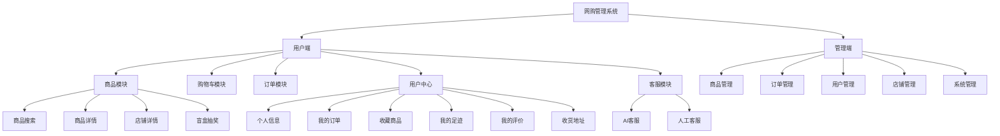
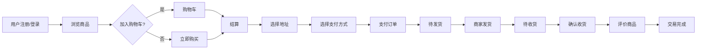
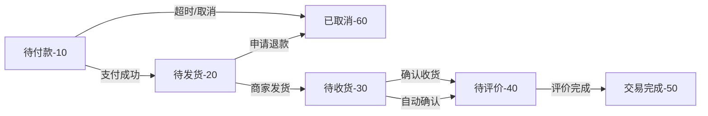
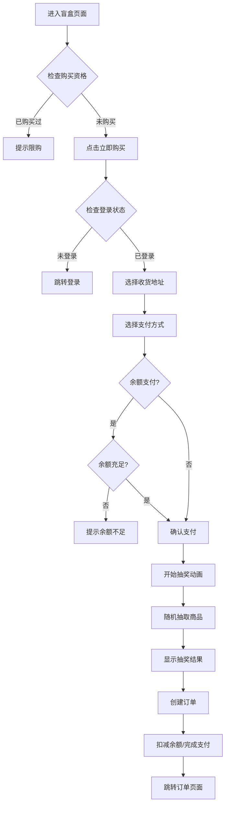

<p style="font-size: 40px; font-weight: bold" align="center">网购管理系统</p>

---

## 一、项目概述

本项目是一个完整的**B2C网上购物平台**，采用前后端分离架构，包含用户端（消费者）和管理端（商家/管理员）两个子系统。系统涵盖商品浏览、购物车、订单管理、在线支付、评价系统、店铺管理、盲盒抽奖等核心电商功能，并集成了AI智能客服和人工客服系统，为用户提供完整的在线购物体验。

**项目结构：**
```
shopping/
├── service/          # 后端服务（Spring Boot多模块）
├── user/             # 用户端前端（Vue3）
└── admin/            # 管理端前端（Vue3）
```

---

## 二、项目技术栈介绍

### 后端技术栈

| 技术 | 版本 | 说明 |
|------|------|------|
| Spring Boot | 2.5.14 | 核心框架 |
| MyBatis-Plus | 3.4.3.4 | ORM框架，简化数据库操作 |
| MySQL | 8.0+ | 关系型数据库 |
| Redis | 6.0+ | 缓存、Session管理 |
| Druid | 1.2.15 | 数据库连接池 |
| JWT | 0.11.2 | 用户身份认证 |
| Swagger/OpenAPI 3 | 3.0.0 | API文档生成 |
| Quartz | - | 定时任务调度 |
| Lombok | 1.18.30 | 简化代码 |
| Hutool | 5.2.5 | 工具类库 |
| POI | 4.1.2 | Excel导入导出 |

### 前端技术栈

| 技术 | 说明 |
|------|------|
| Vue 3 | 前端核心框架（Composition API） |
| Vite | 现代化构建工具 |
| Element Plus | UI组件库 |
| Vue Router | 路由管理 |
| Pinia/Vuex | 状态管理 |
| Axios | HTTP请求库 |
| SCSS | CSS预处理器 |

### 后端模块结构

```
service/
├── Neuedu-admin/       # 主应用模块（Controller层）
├── Neuedu-common/      # 公共工具模块
├── Neuedu-framework/   # 框架核心模块（安全、配置）
├── Neuedu-system/      # 系统管理模块
├── Neuedu-quartz/      # 定时任务模块
├── Neuedu-generator/   # 代码生成器模块
├── Neuedu-online/      # 在线服务模块
└── Neuedu-sports/      # 业务扩展模块
```

---

## 三、项目功能描述

### 1、项目功能

#### 整体功能架构图



#### 功能模块说明

- **功能1：商品模块** - 商品浏览、搜索、分类筛选、商品详情展示、店铺商品列表、盲盒商品抽奖
- **功能2：购物车模块** - 添加商品、修改数量、选择商品、批量删除、计算总价
- **功能3：订单模块** - 创建订单、订单支付（支付宝/微信/余额）、订单取消、确认收货、申请退款
- **功能4：用户中心** - 个人信息管理、收货地址管理、订单管理、商品收藏、浏览足迹、评价管理
- **功能5：客服系统** - AI智能客服（WebSocket实时通讯）、人工客服消息系统
- **功能6：店铺管理** - 店铺信息、商品上架/下架、订单发货
- **功能7：系统管理** - 用户管理、角色权限、菜单管理、字典管理、日志管理

### 2、业务逻辑

#### 整体业务流程



#### 订单状态流转



#### 盲盒购买业务流程



#### 支付类型说明

| 支付类型 | 编码 | 说明 |
|----------|------|------|
| 支付宝 | 1 | 支付宝在线支付 |
| 微信支付 | 2 | 微信在线支付 |
| 银行卡 | 3 | 银行卡支付 |
| 余额支付 | 4 | 账户余额支付 |

### 3、特色亮点

1. **盲盒抽奖功能**
   - 随机抽取平台商品，固定价格500元
   - 每用户限购一次，购买前余额校验
   - 抽奖动画效果，提升用户体验

2. **AI智能客服**
   - 基于WebSocket实时通讯
   - 智能问答，支持订单查询、商品咨询
   - 无缝切换人工客服

3. **完整的订单生命周期管理**
   - 订单超时自动取消（30分钟）
   - 自动确认收货
   - 完整的退款流程

4. **多端适配**
   - 用户端：面向消费者的购物平台
   - 管理端：面向商家和管理员的后台系统

5. **权限控制**
   - 基于RBAC的角色权限模型
   - 细粒度的菜单和按钮权限控制

6. **多方式登录**
   - 基础的用户名密码登录
   - QQ登录

---

## 四、数据库设计

### 1、项目ER图


### 2、项目数据库表

#### 核心业务表

| 表名 | 说明 | 主要字段 |
|------|------|----------|
| `sys_user` | 系统用户表 | user_id, user_name, nick_name, password, balance, status |
| `shop` | 店铺表 | id, shop_name, shop_logo, description, create_user, status |
| `product` | 商品表 | id, name, price, stock, main_image, category_id, shop_id, status, is_hot |
| `product_detail` | 商品详情表 | id, product_id, content |
| `category` | 商品分类表 | id, name, parent_id, level, sort |
| `cart` | 购物车表 | id, user_id, product_id, quantity, selected |
| `order_info` | 订单主表 | id, order_no, user_id, payment, status, address_id, expire_time |
| `order_detail` | 订单明细表 | id, order_no, product_id, quantity, current_unit_price, total_price |
| `order_status_record` | 订单状态记录表 | id, order_no, order_detail_no, status, status_desc |
| `user_address` | 用户地址表 | id, user_id, receive_name, receive_phone, province, city, area, street |
| `user_favorite` | 用户收藏表 | id, user_id, product_id, shop_id, type |
| `user_footprint` | 用户足迹表 | id, user_id, product_id, visit_time |
| `product_comment` | 商品评价表 | id, user_id, product_id, order_no, content, rating, images |
| `customer_message` | 客服消息表 | id, user_id, shop_id, content, sender_type, is_read |
| `recharge_info` | 充值记录表 | id, user_id, amount, payment_type, status |
| `refund_record` | 退款记录表 | id, order_no, refund_amount, refund_status, refund_reason |

#### 订单表字段详情 (order_info)

| 字段名 | 类型 | 说明 |
|--------|------|------|
| id | bigint | 主键 |
| order_no | varchar(50) | 订单编号 |
| user_id | bigint | 用户ID |
| payment | decimal(10,2) | 支付金额 |
| payment_type | int | 支付类型(1支付宝/2微信/3银行卡/4余额) |
| payment_type_desc | varchar(50) | 支付类型描述 |
| postage | decimal(10,2) | 邮费 |
| status | int | 订单状态(10待付款/20待发货/30待收货/40待评价/50完成/60取消) |
| status_desc | varchar(50) | 状态描述 |
| address_id | bigint | 收货地址ID |
| receive_name | varchar(50) | 收货人 |
| receive_phone | varchar(20) | 联系电话 |
| province | varchar(50) | 省份 |
| city | varchar(50) | 城市 |
| area | varchar(50) | 区县 |
| street | varchar(200) | 详细地址 |
| expire_time | datetime | 订单超时时间 |
| payment_time | datetime | 支付时间 |
| ship_time | datetime | 发货时间 |
| receive_time | datetime | 收货时间 |
| cancel_time | datetime | 取消时间 |
| cancel_reason | varchar(200) | 取消原因 |
| create_time | datetime | 创建时间 |
| update_time | datetime | 更新时间 |
| delete_flag | int | 删除标志(0正常/1删除) |

#### 商品表字段详情 (product)

| 字段名 | 类型 | 说明 |
|--------|------|------|
| id | bigint | 主键 |
| name | varchar(200) | 商品名称 |
| price | decimal(10,2) | 商品价格 |
| stock | int | 库存数量 |
| main_image | varchar(500) | 主图URL |
| sub_images | text | 副图URL(多个逗号分隔) |
| category_id | bigint | 分类ID |
| shop_id | bigint | 店铺ID |
| status | int | 状态(0下架/1上架) |
| is_hot | int | 是否热门(0否/1是) |
| sales | int | 销量 |
| create_user | bigint | 创建人 |
| create_time | datetime | 创建时间 |
| update_time | datetime | 更新时间 |
| delete_flag | int | 删除标志 |

---

## 五、项目部署

### 环境要求

| 环境 | 版本要求 |
|------|----------|
| JDK | 1.8+ |
| Maven | 3.6+ |
| MySQL | 8.0+ |
| Redis | 3.0+ |
| Node.js | 22+ |
| pnpm/npm | 最新版 |

### 1、数据库部署

```bash
# 1. 创建数据库
mysql -u root -p
CREATE DATABASE sports DEFAULT CHARACTER SET utf8mb4 COLLATE utf8mb4_unicode_ci;

# 2. 导入数据库脚本（如有SQL文件）
mysql -u root -p sports < your_sql_file.sql
```

### 2、后端部署

```bash
# 1. 进入后端目录
cd service

# 2. 修改数据库配置
# 编辑 Neuedu-admin/src/main/resources/application-dev.yml
# 修改以下配置：
#   spring.datasource.druid.master.url: 数据库地址
#   spring.datasource.druid.master.username: 数据库用户名
#   spring.datasource.druid.master.password: 数据库密码
#   spring.redis.host: Redis地址
#   spring.redis.password: Redis密码

# 3. Maven打包
mvn clean package -DskipTests

# 4. 运行项目
# 方式一：使用脚本
bin\run.bat

# 方式二：直接运行jar
java -jar Neuedu-admin/target/neuedu-admin.jar

# 后端默认端口：9091
# API文档地址：http://localhost:9091/swagger-ui/index.html
```

### 3、用户端前端部署

```bash
# 1. 进入用户端目录
cd user

# 2. 安装依赖
pnpm install
# 或
npm install

# 3. 修改环境配置（可选）
# 编辑 .env.development 文件
# VITE_APP_BASE_API = '/dev-api'  # API代理前缀

# 4. 开发模式运行
pnpm dev
# 或
npm run dev

# 5. 生产环境打包
pnpm build
# 或
npm run build

# 用户端默认端口：80
```

### 4、管理端前端部署

```bash
# 1. 进入管理端目录
cd admin

# 2. 安装依赖
pnpm install
# 或
npm install

# 3. 开发模式运行
pnpm dev
# 或
npm run dev

# 4. 生产环境打包
pnpm build
# 或
npm run build

# 管理端默认端口：81
```

### 5、快速启动脚本

项目提供了便捷的启动脚本：

```bash
# 后端
cd service/bin
run.bat           # 启动后端服务
package.bat       # 打包项目
clean.bat         # 清理编译文件

# 用户端前端
cd user/bin
run-web.bat       # 启动开发服务器
build.bat         # 打包生产版本

# 管理端前端
cd admin/bin
run-web.bat       # 启动开发服务器
build.bat         # 打包生产版本
```

### 6、访问地址

| 服务 | 地址 | 说明 |
|------|------|------|
| 用户端 | http://localhost:18183 | 消费者购物平台 |
| 管理端 | http://localhost:8080 | 商家/管理员后台 |
| 后端API | http://localhost:9091 | RESTful API服务 |
| API文档 | http://localhost:9091/swagger-ui/index.html | Swagger接口文档 |
| Druid监控 | http://localhost:9091/druid | 数据库连接池监控 |

### 7、默认账号

| 端 | 用户名 | 密码 | 说明 |
|----|--------|------|------|
| 管理端 | admin | admin123 | 超级管理员 |
| 用户端 | 自行注册 | - | 普通用户 |

---

## 附录：接口概览

### 主要API模块

| 模块 | 路径前缀 | 说明 |
|------|----------|------|
| 用户认证 | /login, /register | 登录注册 |
| 商品管理 | /shopping/product | 商品CRUD |
| 购物车 | /user/cart | 购物车操作 |
| 订单管理 | /user/orders | 订单CRUD |
| 用户地址 | /user/profile| 地址管理 |
| 店铺管理 | /store/store | 店铺CRUD |
